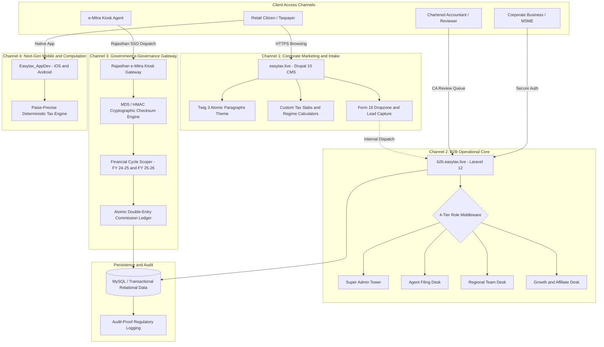

# 🏛️ EasyTax Enterprise Ecosystem: System Design & Architecture Specification

## 1. Executive Architecture Overview

EasyTax operates as an interconnected, multi-tier FinTech and e-Governance ecosystem serving retail taxpayers, corporate enterprises, and thousands of rural/urban kiosk operators across Rajasthan.

---

## 2. Multi-Portal Operational Isolation

The operational core enforces strict role and temporal isolation across four dimensions:

### 1. Role-Based Portals (RBAC)
- **Super Admin**: System configuration, fee schedules, tax regime updates, and aggregate ledger oversight.
- **Kiosk Agent**: Citizen application intake, document vaulting, real-time margin ledger, and sub-agent commission distribution.
- **Regional Team**: Supervisory audits, dispute resolution, and district-level volume analytics.
- **Marketing & Partner**: Growth attribution, affiliate link performance, and milestone rewards.

### 2. Financial Cycle Isolation
Kiosk operators handle both current-year filings and prior-year audits concurrently. To prevent multi-tab session state contamination:
- Every request carries an `X-Financial-Cycle` token (e.g. `2025-2026`).
- Application middleware dynamically binds the cycle to the service container and injects global query scopes across all Eloquent queries.

---

## 3. Cryptographic Gateway Security (e-Mitra)

The Government of Rajasthan e-Mitra integration requires deterministic request signing and bidirectional payload verification:
1. **SSO Token Authenticity**: Verifies incoming government session tokens against the state SSO authority.
2. **Byte-Exact Checksum Validation**: Concatenates `SSOID`, `SERVICEID`, `EMITRATIMESTAMP`, and `SSOTOKEN` without delimiters, generating an MD5 digest matching the government verification server.
3. **Replay-Attack Protection**: Rejects payloads with timestamps deviating by more than 300 seconds from UTC/IST synchronized clocks.

---

## 4. Double-Entry Commission Accounting

Agent payouts and kiosk margins are processed through an atomic double-entry ledger service:
- No raw balance mutations (`$agent->balance += 100`).
- Every completed filing generates paired credit and debit entries in a database transaction (`DB::transaction`).
- Balances are computed through indexed ledger aggregation, preventing race conditions under high concurrent kiosk usage.
